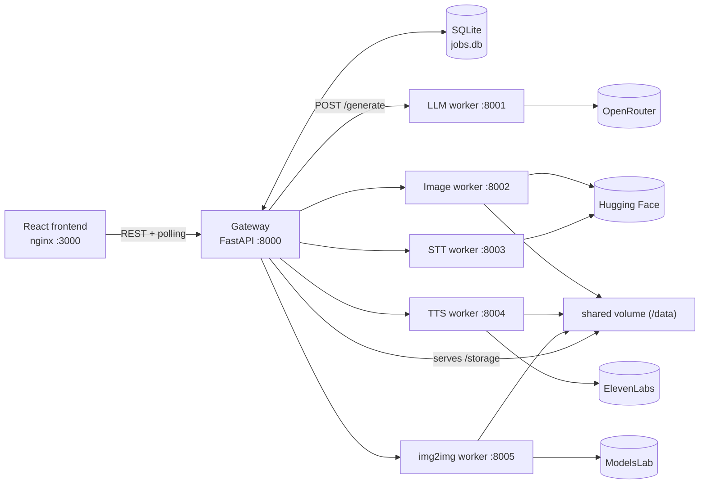

# Genesis — Multimodal Generative AI Platform

A microservices platform that runs text, image and speech generation as asynchronous jobs: a FastAPI gateway orchestrates five worker services that call hosted AI APIs, behind a React + TypeScript frontend.

## What it does

You pick a pipeline in the web UI (or call the REST API). The gateway stores the job, runs it in the background, and the UI polls until it shows the result.

| Pipeline | Flow | Provider / model (defaults in code) |
|---|---|---|
| `text_to_text` | LLM worker | OpenRouter, `openai/gpt-3.5-turbo` |
| `text_to_image` | (optional LLM prompt rewrite for a chosen style) → image worker | Hugging Face Inference, SDXL base 1.0, falling back to SD 1.5 / SD 2.1 |
| `text_to_speech` | TTS worker | ElevenLabs, `eleven_turbo_v2_5` |
| `speech_to_text` | STT worker | Hugging Face Inference, Whisper large-v3 |
| `speech_to_image` | STT → LLM prompt cleanup → image worker | chains the three above |
| `image_to_image` | img2img worker | ModelsLab img2img API, `flux-kontext-dev` |

All inference runs through external APIs, so no GPU is needed. Generated images and audio are written to a shared volume and served by the gateway under `/storage/...`.

The UI has three pages: create a job, follow a job (polls every 2 s, shows text/image/audio output), and view job history.

## Tech stack

- **Backend:** Python 3.11, FastAPI, Pydantic, httpx (async), SQLite for job state
- **Frontend:** React 18, TypeScript, Vite, Tailwind CSS, Radix UI primitives, React Router; served by nginx
- **Infrastructure:** Docker images per service, Docker Compose. Kubernetes (k0s) manifests in `k8s/`.
- **External APIs:** OpenRouter, Hugging Face Inference, ElevenLabs, ModelsLab

## Architecture



**Job lifecycle:** `POST /jobs` validates the inputs for the pipeline, saves the job as `queued` in SQLite, and returns the job ID straight away. A FastAPI background task then runs `PipelineExecutor`, which calls the workers over HTTP in sequence (for multi-step pipelines like speech → image). It stores the outputs (or the error message) and marks the job `completed` or `failed`. Clients poll `GET /jobs/{id}`.

Each worker is a small stateless FastAPI service with `GET /health` and `POST /generate`. To change providers, you change only the matching worker.

More detail: [`architecture/pipelines.md`](architecture/pipelines.md) and [`architecture/system_diagram.md`](architecture/system_diagram.md).

## Getting started (Docker Compose)

Prerequisites: Docker with Compose, plus API keys for the providers you want to use.

```bash
git clone https://github.com/amine-mosbah/genesis-multimodal-ai.git
cd genesis-multimodal-ai

# 1. Build all seven images (gateway, frontend, 5 workers)
./build-images.sh

# 2. Provide API keys (Compose reads .env automatically; .env is git-ignored)
cat > .env <<'EOF'
OPENROUTER_API_KEY=...
HUGGINGFACE_API_KEY=...
ELEVENLABS_API_KEY=...
MODELSLAB_API_KEY=...
EOF

# 3. Start everything
docker compose up
```

- Frontend: http://localhost:3000
- Gateway API docs (Swagger): http://localhost:8000/docs

Example request:

```bash
curl -X POST http://localhost:8000/jobs -H 'Content-Type: application/json' \
  -d '{"pipeline": "text_to_image", "inputs": {"text": "a lighthouse at dusk"}, "options": {"style": "cinematic"}}'
curl http://localhost:8000/jobs/<job_id>
```

### Kubernetes (k0s)

`k8s/` has a namespace, ConfigMap, Secret template, PV/PVC (hostPath), Deployments and Services for every component, plus an optional Ingress. You can apply them with `make deploy`, and `make status` / `make logs` help you inspect the cluster. These manifests have not been updated for the ElevenLabs and ModelsLab workers, which still receive only a Hugging Face key. Treat this path as work in progress. See [`DEPLOYMENT.md`](DEPLOYMENT.md) and [`architecture/k8s_design.md`](architecture/k8s_design.md).

## API

| Method | Path | Purpose |
|---|---|---|
| `POST` | `/jobs` | Create a job (`pipeline`, `inputs.text` / `audio_url` / `image_url`, `options`) |
| `GET` | `/jobs/{job_id}` | Job status and outputs |
| `GET` | `/jobs?limit=&offset=` | Job history |
| `GET` | `/pipelines` | Supported pipelines |
| `GET` | `/storage/images/{file}`, `/storage/audio/{file}` | Generated files |

## Project structure

```
gateway/            FastAPI gateway: main.py (routes), db.py (SQLite), schemas.py,
                    services/pipeline_executor.py (multi-step orchestration)
workers/            One FastAPI service per capability: llm, image, stt, tts, cyclegan (img2img)
frontend/           React + Vite + Tailwind SPA (CreateJob, JobDetail, JobHistory pages)
k8s/                Kubernetes manifests (namespace, config, storage, deployments, ingress)
architecture/       Design notes: pipelines, system diagram, k8s design
docker-compose.yml  Local multi-container setup
build-images.sh     Builds all Docker images
```

## Current limitations

- Speech and image inputs must be **public URLs**. The upload endpoint isn't implemented yet.
- Jobs run as in-process background tasks, not on a message queue. A job is marked `running` only in memory, so the stored status goes from `queued` straight to `completed` or `failed`.
- No authentication, rate limiting or automated tests yet. CORS is open.
- SQLite is the only database implemented.

## Author

Mohamed Amine Ben Mosbah, software engineering student at ENISo (Tunisia) · [github.com/amine-mosbah](https://github.com/amine-mosbah)
